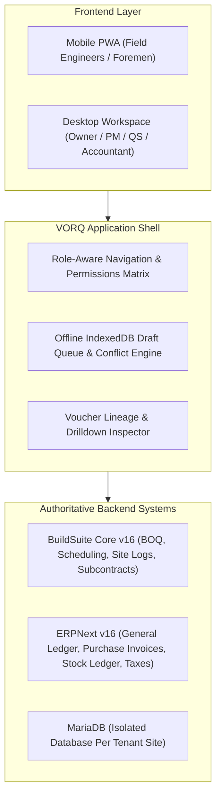

<p align="center">
  
</p>

<h1 align="center">VORQ</h1>

<p align="center">
  <strong>Role-Aware Construction Operations & Authoritative Financial-Control Platform</strong><br>
  <em>Engineered for Indian Residential & Low-Rise Commercial Contractors (Bhubaneswar-Cuttack Region)</em>
</p>

<p align="center">
  <a href="#-architecture-at-a-glance"></a>
  <a href="#-functional-golden-paths"></a>
  <a href="#-offline-pwa-field-capability"></a>
  <a href="#-license--upstream-governance"></a>
</p>

---

## 📌 Executive Product Summary

**VORQ** delivers a unified, trustworthy view of project costs, on-site material consumption, daily labour muster, subcontractor progress billing, client receivables, and cash exposure without spreadsheet re-entry.

### 🚫 The Industry Problem
Contractors typically spread operational and commercial data across WhatsApp messages, paper site registers, accountant spreadsheets, and manual Tally vouchers. This causes critical reconciliation delays between:
1. **BOQ (Bill of Quantities)** baseline revisions.
2. **On-site material consumption** vs. vendor receipts.
3. **Labour muster** attendance vs. daily wages.
4. **Subcontractor measured work** vs. retention deductions.
5. **Client milestone claims** vs. bank realizations.

### 💎 VORQ's Non-Negotiable Value Promise
> **Zero Fabricated Metrics**: Every KPI shown on an executive card traces directly back to underlying ERP vouchers, stock ledger entries, or immutable baseline revisions. If reconciled data is incomplete, VORQ marks it **`Data Incomplete / Unavailable`** rather than displaying speculative numbers.

---

## 🏗️ Architecture at a Glance

VORQ reuses proven open-source logic rather than attempting a risky, fragile ground-up rewrite:



---

## 👥 8 Tailored Personas & Role-Aware Navigation

VORQ enforces role-based access control where permissions are enforced at the server transaction boundary:

| Persona | Landing View | Primary Responsibilities | Strict Access Restrictions |
| :--- | :--- | :--- | :--- |
| **👑 Owner / Director** | Portfolio & Risk | Portfolio P&L, budget vs. actual, open commitments, cash gap, approvals | Cannot bypass financial audit trail |
| **📋 Project Manager** | Projects & Schedule | Gantt schedules, work packages, task blockers, site approvals | No unrestricted company GL editing |
| **📐 Quantity Surveyor (QS)** | BOQ & Estimates | BOQ baseline locking (`REV-1.0`), rate library, subcontractor measurement books | Cannot post sales invoices without finance signoff |
| **👷 Site Engineer** | Today's Site Log | Daily site progress report, weather, task completion %, photos, field muster | No company-wide portfolio financials |
| **📦 Storekeeper** | Materials & Stock | Goods Receipt Notes (GRN), warehouse stock, material issues to tasks | Cannot modify purchase rates or accounting journals |
| **🛒 Procurement Officer** | Materials Management | Material requisitions, purchase order (PO) drafts, vendor comparisons | Cannot post bank payments |
| **💼 Accountant** | Finance & Invoices | Client milestone invoices (18% GST), collections, ERPNext GL reconciliation | Cannot approve own transactions under maker-checker |
| **🤝 Subcontractor (External)**| Subcontracts Portal | Assigned trade scope, cumulative measured bills, retention status | Zero access to other vendors, payroll, or portfolio |

---

## ⚡ Core Operational Modules (Golden Paths)

### 1. Executive Portfolio Control & Risk ([OwnerDashboard.tsx](src/components/views/OwnerDashboard.tsx))
- **Consolidated Multi-Site Monitoring**: Real-time tracking of active residential projects in the Bhubaneswar-Cuttack corridor.
- **Financial Triad**:
  - **Approved Baseline Budget**: Locked revision hash with itemized BOQ backup.
  - **Actual Posted Cost**: Live GL vouchers (Purchase Invoices, wage distributions, material issues).
  - **Open Commitments**: Active purchase orders and approved subcontracts awaiting delivery.
- **One-Click Ledger Drilldown**: Inspect every underlying transaction voucher, cost code, party, and posting status directly in a modal drawer.

### 2. BOQ Revision Control & Baseline Locking ([BOQWorkspace.tsx](src/components/views/BOQWorkspace.tsx))
- Hierarchical cost codes:
  - `1000` Substructure & Foundations
  - `2000` Superstructure (RCC Frames, Masonry)
  - `3000` Architectural Finishes
  - `4000` MEP & Utilities
- **Immutable Baseline**: Revision `REV-1.0` locked with cryptographic baseline hash `bl_8a92f09c62b47`.
- Full import/export support with CSV validation against master rate catalog.

### 3. Field PWA & Offline Site Logs ([SiteDailyReportView.tsx](src/components/views/SiteDailyReportView.tsx))
- Built specifically for weak or zero-connectivity site conditions in Odisha.
- **Offline Draft Storage**: Automatically persists progress to device IndexedDB when disconnected (`Site Offline`).
- **One-Tap Sync**: Automatically checks server idempotency keys and reconciles attachments upon reconnection.
- Captures ambient weather, temperatures, site blockers, work-in-progress %, and photo evidence.

### 4. Labour Muster & Wage Costing ([LabourMusterView.tsx](src/components/views/LabourMusterView.tsx))
- Fast trade entry for Head Masons (*Mistri*), Skilled Masons, Bar Benders, Carpenters, and Unskilled Helpers.
- **Duplicate-Date Protection**: Prevents double-booking workers on the same site and date.
- Directly charges wage expenditure to work package cost codes.

### 5. 5-Stage Material Protection ([MaterialsManagement.tsx](src/components/views/MaterialsManagement.tsx))
Strict accounting segregation ensures inventory truth:
$$\text{Requisition} \longrightarrow \text{Purchase Order (PO)} \longrightarrow \text{Goods Receipt (GRN)} \longrightarrow \text{Site Warehouse Stock} \longrightarrow \text{Task Consumption Issue}$$
- **Negative Stock Blockers**: Prevents issuing more cement, steel, or sand than physically delivered to the site.

### 6. Subcontractor Measured RA Bills & Retention Waterfall ([SubcontractsView.tsx](src/components/views/SubcontractsView.tsx))
- Cumulative measurement books recording previous certified vs. current measured work.
- **Auditable Deduction Waterfall**:
  $$\text{Net Payable} = \text{Current Gross Work} - 5\%\text{ Retention} - \text{Advance Recovery} - \text{Other Deductions}$$
- Approved bills automatically trigger idempotent ERPNext Purchase Invoices (`PINV-2026-1049`).

### 7. Unified Authorization Center ([ApprovalsCenter.tsx](src/components/views/ApprovalsCenter.tsx))
- Consolidated inbox for Purchase Orders, Subcontract Bills, Material Requests, and BOQ Amendments.
- Real-time budget impact analysis and auditable rejection reason logs.

---

## 💻 Tech Stack & Engineering Standards

- **Frontend Core**: React 19, TypeScript 5.7, Vite 6.1
- **Styling & Design Tokens**: Tailwind CSS, Lucide Icons, Custom VORQ Design Tokens
- **State & Offline Storage**: React Context + IndexedDB / LocalStorage Queue
- **ERP Integration Layer**: Frappe REST / RPC API adapters with ERPNext v16 & BuildSuite Core

---

## 🚀 Quickstart Guide

### Prerequisites
- Node.js `>= 18.x` (Tested on `v24.18.0`)
- npm `>= 9.x`

### Installation & Run

```bash
# 1. Clone the repository
git clone https://github.com/Sarthak702-droid/VORQ.git
cd VORQ

# 2. Install dependencies
npm install

# 3. Start local development server
npm run dev
```

Open your browser at **`http://localhost:5173`**.

### Production Build & Preview
```bash
npm run build
npm run preview
```

---

## 🧪 Testing the Interactive Prototypes

1. **Test Personas**: Click **Active Persona** on the top navigation bar to switch between *Owner*, *Site Engineer*, *Quantity Surveyor*, *Storekeeper*, *Accountant*, etc. Notice how permissions and views dynamically adapt.
2. **Test Offline Sync**: Click the **Online** badge on the top right to toggle **Site Offline**. Go to **Today's Site Log**, fill out a report, and click **Save Local Draft**. Toggle back to **Online** and click **Sync** to watch it commit to the audit register.
3. **Test Ledger Lineage**: On the **Portfolio & Risk** dashboard, click **Drilldown** on any KPI to verify the exact ERP ledger vouchers backing that number.

---

## 📜 Repository Structure

```text
VORQ/
├── assets/                  # Brand assets & logos
│   └── vorq-logo.jpeg       # Official VORQ Glassmark Logo
├── docs/                    # Specification documents (PRD, Arch, UI/UX, Frontend)
│   ├── VORQ_01_PRD.txt
│   ├── VORQ_02_Tech_Arch.txt
│   ├── VORQ_03_UI_UX.txt
│   └── VORQ_04_Frontend_Spec.txt
├── public/                  # Static assets
│   └── assets/vorq-logo.png
├── src/
│   ├── components/
│   │   ├── common/          # KPICard, DrilldownModal
│   │   ├── layout/          # Navbar, Sidebar, MobileNav
│   │   └── views/           # 8 Domain Workspaces
│   ├── context/             # Domain state & offline sync logic (AppContext.tsx)
│   ├── data/                # Seed database & reference test fixtures (mockDatabase.ts)
│   ├── types/               # TypeScript domain models (index.ts)
│   ├── App.tsx              # Main application shell
│   ├── index.css            # VORQ design tokens & typography
│   └── main.tsx             # Application bootstrap
├── package.json
├── tailwind.config.js
└── vite.config.ts
```

---

## 📄 License & Upstream Governance

- **VORQ Core App**: Licensed under the [MIT License](LICENSE).
- **ERP Foundation**: ERPNext and Frappe Framework are licensed under GNU General Public License v3.0 (GPL-3.0).
- **Construction Workflows**: BuildSuite Core baseline is licensed under MIT.
