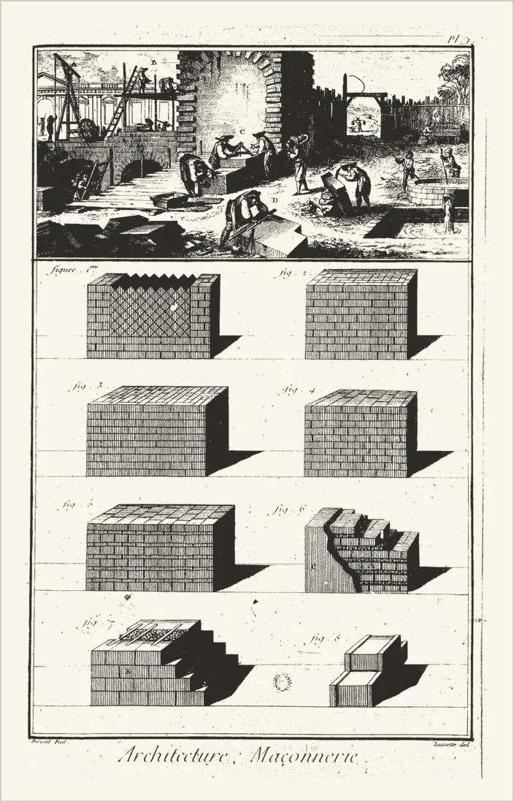
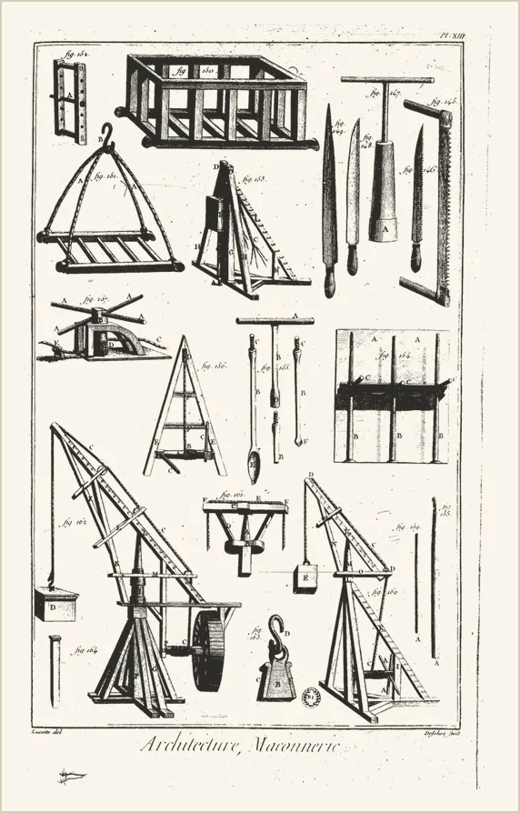
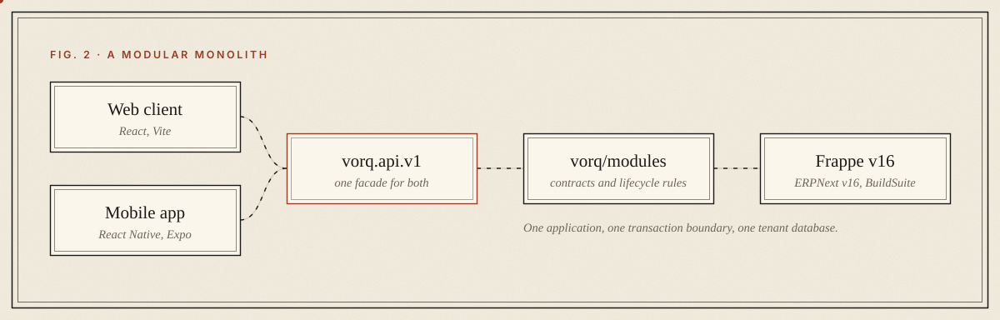
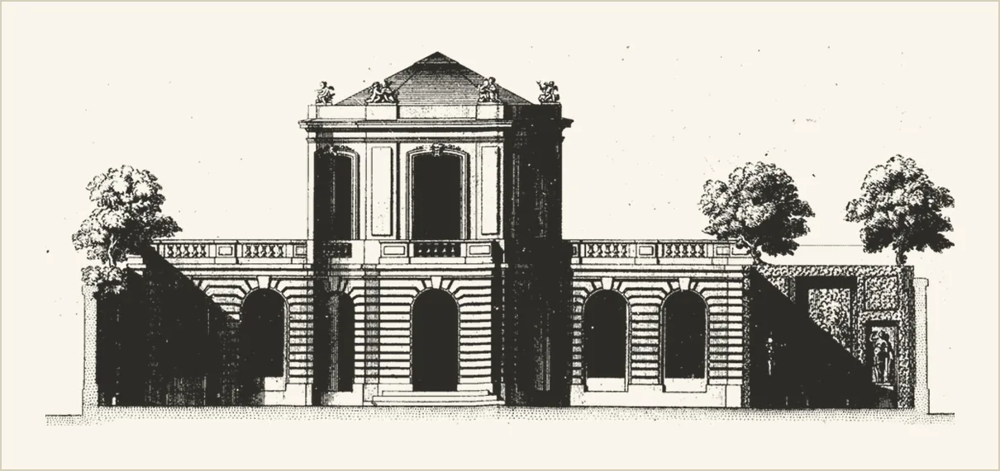

<a id="top"></a>

<p align="center">
  
</p>

<p align="center">
  <a href="#i-what-it-keeps">I. What it keeps</a> &nbsp;·&nbsp;
  <a href="#ii-a-worked-example">II. A worked example</a> &nbsp;·&nbsp;
  <a href="#iii-setting-up">III. Setting up</a> &nbsp;·&nbsp;
  <a href="#iv-how-it-is-built">IV. How it is built</a> &nbsp;·&nbsp;
  <a href="#v-who-gets-in">V. Who gets in</a> &nbsp;·&nbsp;
  <a href="#vi-proofs">VI. Proofs</a>
</p>

<p align="center">
  <em>Construction operations and billing on Frappe v16, ERPNext v16 and BuildSuite,<br>
  with a React web client and a React Native mobile app.</em>
</p>


<table>
<tr>
<td width="38%" valign="top">
  
  <p align="center"><sub><em>Masons on site, and eight ways to bond a wall. Engraved by Prévost after Lucotte for the Encyclopédie, Paris, 1762.</em></sub></p>
</td>
<td valign="top">

### To the reader

VORQ is construction management software for residential contractors. The estimate, purchase orders, store stock, labour attendance, subcontract work and client bills for a project all sit on the same record, so the office and the site work from the same numbers.

It works in the browser and on the phone, with the same login. Both clients use the same backend accounts, company and project membership, and server permissions.

The main web entry loads the real ERP client, not the archived persona-switching demo.

**The chapters below open when you click them.**

</td>
</tr>
</table>


## I. What it keeps

Seven parts of the job, all tied to the same project.

<details open>
<summary><b>1. Estimates and BOQ</b></summary>

> Quantities, rates and the budget for each project.
</details>

<details>
<summary><b>2. Purchasing</b></summary>

> Material requests, purchase orders, and what the supplier actually delivered.
</details>

<details>
<summary><b>3. Stores</b></summary>

> Stock received, issued and lying at each site.
</details>

<details>
<summary><b>4. Site reports</b></summary>

> What was done today, entered from the phone on site.
</details>

<details>
<summary><b>5. Labour</b></summary>

> Daily attendance, site by site.
</details>

<details>
<summary><b>6. Subcontracts</b></summary>

> Work orders and the progress against each one.
</details>

<details>
<summary><b>7. Billing and accounts</b></summary>

> Client bills, payments and approvals. Tax and ledger posting are done on the server by ERPNext.
</details>

<details>
<summary><b>Which client does what</b></summary>

<br>

| Client | What it loads |
| :-- | :-- |
| **Web** | The ERP workspace: authorised planning, procurement, stock, contract and finance modules. |
| **Mobile** | Assigned projects, server-backed document entry, site reports, labour attendance and billing modules, according to backend permissions. |

Taxes, certification and financial posting remain server responsibilities.

The old mock components remain as reference and are not loaded by the web or mobile entry points. Earlier local-only mobile records are not automatically imported into server accounts.
</details>

<p align="right"><a href="#top"><sub>↑ back to the title page</sub></a></p>


## II. A worked example

One BOQ line, brick masonry, followed from the estimate to the client's bill.

<p align="center">
  
</p>

<details>
<summary><b>The same ledger as plain text</b></summary>

<br>

| Stage | Entry | Quantity | Amount |
| :-- | :-- | --: | --: |
| *Estimate* | BOQ item 4.2, brick masonry 230 mm | 184.00 cum | ₹11,86,800 |
| *Purchasing* | Purchase order to the brick supplier | 92,000 nos | ₹8,28,000 |
| *Stores* | Received at the site store so far | 30,000 nos | |
| *Site report* | Masonry completed to date | 62.50 cum | |
| *Billing* | Included in running bill no. 3 | 48.00 cum | ₹3,09,600 |

Figures are invented for the example but consistent: 184 cum at ₹6,450, and about 500 bricks to the cum at ₹9 each.
</details>

<p align="right"><a href="#top"><sub>↑ back to the title page</sub></a></p>


## III. Setting up

<table>
<tr>
<td valign="top">

Three things to raise, in this order.

<details open>
<summary><b>First, the backend</b></summary>

<br>

Install Docker with Compose and Python 3, then run this from the repository root.

```bash
bash scripts/dev-up.sh
```

The script builds the local backend with authentication included, starts the site and runs migrations. It stores the development administrator password in the ignored `deployment/.env`. Rerun it after backend source changes.

</details>

<details open>
<summary><b>Second, the web client</b></summary>

<br>

Use Node.js 24 or newer.

```bash
npm ci
npm run dev
```

Web: `http://localhost:5173`. Its `/api` routes proxy to the local VORQ backend at `http://127.0.0.1:18080`.

Signed-out visitors see the landing page at `/`. Sign-in and account creation live at `/#/signin` and `/#/signup`. These public screens are in `src/erp/public/` (landing, logo, styles) and `src/erp/AuthScreen.tsx`.
</details>

<details>
<summary><b>Third, the mobile app</b></summary>

<br>

```bash
cd mobile
npm ci
npm start -- --web --port 8082 --localhost
```

Mobile browser preview: `http://localhost:8082`. Native-device connection and HTTPS configuration are documented in [mobile/README.md](mobile/README.md).
</details>

</td>
<td width="30%" valign="top">
  
  <p align="center"><sub><em>Hoists, shear legs and tackle, from the masonry plates of the same volume.</em></sub></p>
</td>
</tr>
</table>

<p align="right"><a href="#top"><sub>↑ back to the title page</sub></a></p>


## IV. How it is built

<p align="center">
  
</p>

The backend is a modular monolith. Business modules run inside one Frappe application, share its transaction boundary and tenant database, and use ERPNext and BuildSuite controllers for authoritative operations.

<details>
<summary><b>The facade, the modules, the services</b></summary>

<br>

| Part | What it does |
| :-- | :-- |
| `vorq.api.v1` | The stable facade. It serves both web and mobile. |
| `vorq/modules/` | Domain contracts and construction lifecycle rules. |
| Application services | Coordinate access checks, scoped records and idempotency. |

See [module boundaries and deployment](docs/architecture/MODULAR_MONOLITH.md).
</details>

<details>
<summary><b>Where things are in this repository</b></summary>

<br>

| Path | Contents |
| :-- | :-- |
| `src/erp/` | The web ERP client, the sign-in screen and the public landing page. |
| `mobile/` | The React Native (Expo) app. |
| `apps/vorq/` | The modular Frappe application, including authentication. |
| `deployment/` | Docker image and Compose configuration for local development. |
| `backend/auth-upgrade/` | Authentication protocol guide and patch for older backend checkouts. |
| `tests/` | Auth, architecture and live verification suites. |
| `docs/` | Product, architecture and UI specifications, and the test report. |
| `public/plates/` | The 1762 engravings. |
</details>

<p align="right"><a href="#top"><sub>↑ back to the title page</sub></a></p>


## V. Who gets in

> **Accounts are approved by a person.** Signup requests do not grant Owner, Accountant or any other ERP access. An administrator must verify identity and assign company and project membership and upstream roles.

<details open>
<summary><b>Eight roles</b></summary>

<br>

| | | | |
| :-- | :-- | :-- | :-- |
| Owner | Project Manager | Quantity Surveyor | Site Engineer |
| Storekeeper | Procurement Officer | Accountant | Subcontractor |
</details>

<details>
<summary><b>What signing in involves</b></summary>

<br>

- Shared signup and login with email, unique username, strong password, requested role and company, and role-specific details.
- One-use image CAPTCHA on signup and password login.
- Authenticator QR enrolment, TOTP confirmation, subsequent code login and one-use recovery codes.
- Server-side session assurance, expiry, replay protection and rate limits.
</details>

<details>
<summary><b>Sessions, and what is not built yet</b></summary>

<br>

Authentication uses revocable Frappe sessions and CSRF. It does **not** use JWT. Browser cookies are HttpOnly; native session IDs use SecureStore.

The [auth guide](backend/auth-upgrade/README.md) describes the protocol, database models, deployment and limits.

Email addresses are collected, but automated ownership verification and delivery are not implemented.
</details>

<p align="right"><a href="#top"><sub>↑ back to the title page</sub></a></p>


## VI. Proofs

<details open>
<summary><b>Checks to run</b></summary>

<br>

```bash
npm run build
npm run test:auth
npm run test:auth:policy
npm run test:architecture
```
</details>

<details>
<summary><b>Live suites</b></summary>

<br>

```bash
npm run test:backend:live
npm run test:http:live     # needs the web dev server on port 5173
```

The live suite uses an unprivileged synthetic identity, posts no financial transactions, and never enrols a real administrator.
</details>

<details>
<summary><b>Evidence on file</b></summary>

<br>

- [The full local test report](docs/TEST_REPORT.md): regression coverage, fixed defects, browser evidence and remaining limits.
- `auth-verification.json`: local live-auth evidence.
- The [backend](backend/auth-upgrade/README.md) and [mobile](mobile/README.md) guides document the remaining physical-device and production deployment checks.
</details>

<p align="right"><a href="#top"><sub>↑ back to the title page</sub></a></p>


<p align="center">
  
</p>

<h3 align="center">Colophon</h3>

<p align="center">
  <em>The engravings in <code>public/plates/</code> are from the plate volumes of Diderot and d'Alembert's Encyclopédie (1762),<br>
  public domain, sourced from Wikimedia Commons.</em>
</p>

<p align="center">
  <em>The mark is a keystone with a V cut into it: the last stone set in an arch, the one that locks the rest in place.</em>
</p>

<p align="center">
  <sub>Released under the <a href="LICENSE">licence</a> in this repository.</sub>
</p>
