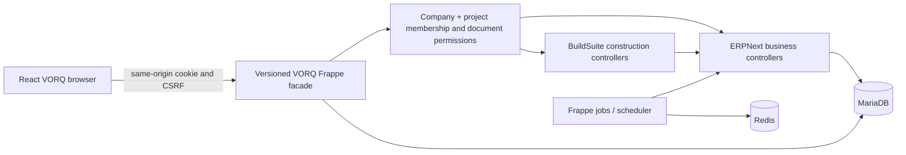

# System architecture — current implementation

The VORQ application is a [modular monolith](MODULAR_MONOLITH.md): a stable HTTP facade delegates to application services and domain-owned contracts/policies within the same Frappe process and transaction boundary. See that guide for module ownership, dependency rules and verification.

Development services: ERPNext backend, Nginx frontend gateway on localhost:18080, websocket, workers, scheduler, MariaDB and two Redis services. React Vite runs on localhost:15173 with same-origin API proxy. BuildSuite and VORQ are custom app layers; Frappe/ERPNext core remain unmodified. This Compose derives from the official demonstration stack and is explicitly not a production deployment.

Tenant boundary: separate Frappe site/database per tenant. Company boundaries inside a tenant are explicit membership checks plus upstream permissions. Document authority is MODULE_OWNERSHIP.md. No external estimation/scheduling service is active. Site-specific configuration, secrets and database volumes stay out of Git.

Production requires TLS, digest-pinned images, isolated site provisioning, secret management, observability, tested restore, migration rollback, CSP, security review and deployment acceptance. The filename records the requested deliverable; it does not imply the architecture is production-final.
