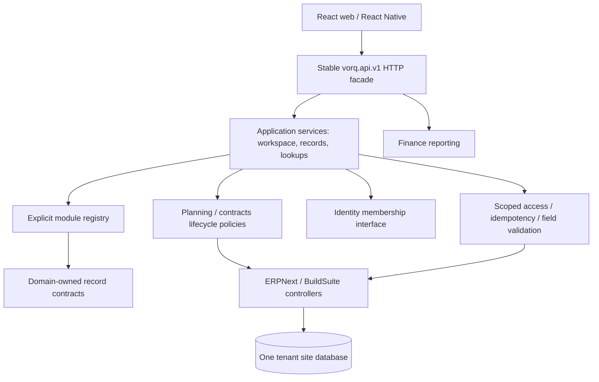

# VORQ modular monolith

VORQ runs as one deployable Frappe application with ERPNext and BuildSuite. Web and mobile remain clients of the same versioned API. All modules use the existing site database, Frappe transactions, worker pool and scheduler. Module separation introduces no network hops or distributed transactions.



| Module | Owned records and rules |
| --- | --- |
| Identity | Membership interface; CAPTCHA, MFA, session lifecycle and account registration retain their existing `auth_flow`, `auth_policy`, `permissions` and `registration` implementation paths for hooks and auth overlay compatibility |
| Masters | Customer, supplier, item, warehouse contracts |
| Planning | Projects, tasks, BOQ revisions/groups/items; BOQ editing and approval rules |
| Site operations | Site reports and labour attendance contracts |
| Procurement | Material requests and purchase orders |
| Inventory | Purchase receipts and stock movements |
| Contracts | Work orders, measurements, RA bills; immutable certification and quantity/retention validation |
| Finance | Invoice/payment/journal contracts and role policy; authorised project ledger reporting |

## Dependency rules

- `api/v1.py` owns HTTP signatures and GET/POST/guest restrictions. The session and authentication adapters keep their established paths. Other endpoints delegate to internal use cases.
- `application/` coordinates cross-domain use cases. Shared CRUD mechanics include schema allowlists, company/project scope, upstream document permissions, optimistic concurrency and request idempotency. Domain-specific lifecycle commands delegate to the owning module.
- `module_registry.py` explicitly combines each module's contracts and rejects duplicate record identifiers. Existing `catalog.py` imports remain compatible.
- Business modules cannot import the HTTP layer, application orchestration, registry or sibling business modules. Cross-domain coordination belongs in the application layer. Identity membership and finance reporting use the existing permission implementation.
- `shared/` contains transaction-line contracts, finite-decimal validation and request deduplication. It does not own business lifecycle rules.
- `validation.py` preserves existing Frappe document-hook paths while delegating construction invariants to their owners.

ERPNext and BuildSuite own posting, totals, stock and upstream document lifecycle. Domain modules continue to use those controllers in process. Document scope checks remain centralized in `application/access.py` because linked project/company references span several modules. No module commits independently; exceptions leave rollback to Frappe.

## Compatibility and deployment

There are no endpoint, payload, database schema or client configuration changes. Web and mobile source remains unchanged. No data migration is needed for this refactor. Existing tenant-per-site isolation remains in place.

Rebuild the existing VORQ image and restart its backend/workers/scheduler together using the established deployment procedure. The local development stack was rebuilt, backed up, migrated and restarted on 6 November 2026; this does not deploy to production. The historical auth installer recognizes the modular source and checks the installed security boundary before refreshing the auth overlay; it still supports older unrefactored sources.

## Verification

From the repository root:

```bash
npm run build
npm run test:auth
npm run test:auth:policy
npm run test:architecture
```

Architecture checks enforce dependency direction, unique record ownership, all public endpoint signatures and HTTP restrictions, internal services remaining unwhitelisted, BOQ/measurement immutability, denied approval roles and upstream command delegation. These local tests do not substitute for live ERPNext database acceptance. Run the existing `vorq.smoke.run` acceptance procedure against a rebuilt test deployment before production rollout.

## Local runtime verification — 6 November 2026

The rebuilt image is running on the local development stack. A database-and-files backup completed before migration. All nine long-running Compose services were up after verification, and backend, workers, scheduler and gateway used the same rebuilt image.

The existing development ERP acceptance story passed for project `PROJ-0003`: procurement receipt and material issue produced a stock delta of 7; ledger entries balanced; BOQ approval and measurement-based RA billing passed with gross 800 and retention 40; idempotency and denied nonmember access passed. The story creates persistent, labeled development records. No bank transfer or payment acceptance was performed.

All 22 record read contracts, workspace composition, RA bill detail, finance overview and supplier lookup passed against the live database through trusted bench. HTTP checks passed for all four auth routes, CAPTCHA, synthetic signup, TOTP enrollment, replay protection, recovery codes, logout revocation and role isolation. See `modular-monolith-verification.json` and `auth-verification.json` for evidence. This is local development evidence, not production certification.

The first post-restart HTTP check exposed Nginx holding the backend's previous container IP. Restarting the frontend resolved it; `scripts/dev-up.sh` now includes that restart so subsequent deployments refresh the upstream address.

## Deeper regression pass

A subsequent ordinary-user and malformed-input test pass found and fixed financial lookup gating, disabled-subcontractor access outside record endpoints, and invalid pagination/module inputs. The final local image ends in `...f13a42c`. `docs/TEST_REPORT.md` records 15 live database cases, 36 authenticated HTTP checks, browser/public-form checks, mobile builds and the exact limits of verification.
